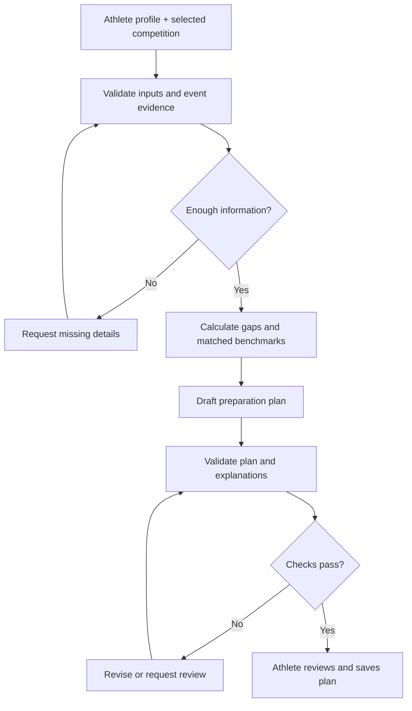

# Module 07: external integrations and AI workflow

## Ownership and boundary
Own Claude, Tavily, Firecrawl, and mock adapters, plus extraction proposals and bounded orchestration. Use SETUP for credentials and CONTRACTS for interface shapes. External services cannot bypass domain rules or authorization.

## Initial versus later work
Initially implement deterministic mocks and a tested Claude adapter. Live Tavily/Firecrawl, Supabase account activation, broader adapters, and durable workers follow the core demo. Allow manual competition entry throughout. No verified source API or scraping permission is established by this handoff.

## Agent responsibilities
## How agents fit into the app

Use a **controlled agent workflow**. The product benefits from AI, but every backend task does not need an autonomous agent.

| Component | AI responsibility | Code or human responsibility |
| --- | --- | --- |
| Research agent | Find candidate competition pages within permitted sources | Fetch limits, source policy, date/location filtering, and deduplication |
| Extraction step | Convert page text into a proposed structured event record | Schema and unit checks; user/admin confirmation |
| Assessment service | Explain calculated gaps in accessible language | Eligibility rules, event matching, ratios, percentiles, and evidence labels |
| Planning agent | Select and explain an equipment-aware plan from reviewed material | Enforce schedule, exercise, load, and scope constraints |
| Review step | Identify missing evidence or unsupported statements | Hard validation must block invalid outputs |
| Application backend | No agent needed | Authentication, persistence, training logs, access control, and job status |

These are logical responsibilities. The MVP does not need one independently running agent per row. Start with one orchestrated workflow, a few structured model calls, and deterministic services; separate agents only where tool selection or independent reasoning adds value.

### Workflow

LangGraph is a candidate orchestration runtime because its official documentation describes mixing deterministic and agentic steps with persistence and human review [S6]. It is an implementation option, not a requirement for product usefulness.

Use bounded tool calls, structured outputs, timeouts, limited retries, and explicit failure states. Treat fetched pages as untrusted data: page content cannot grant tools new permissions or override application instructions. An additional LLM reviewer does not replace validation.

## Source handling
## Data acquisition and quality

### Candidate sources

| Source | Potential use | Limit to resolve |
| --- | --- | --- |
| Organizer submissions | Competition requirements and official result files | Permission, completeness, and updates |
| Strength Register [S1] | Competition and gym discovery | Geographic coverage and reuse permission |
| Iron Podium [S2] | Competition descriptions and results | Authorized access, permitted reuse, and dataset fit |
| Strongman Archives [S3] | Historical contest and athlete context | Permission and relevance to the intended cohort |
| Federation information [S4] | Eligibility and qualification rules | Jurisdiction, effective date, and organizer exceptions |
| Athlete training logs | Personal preparation evidence | Consent, accuracy, and comparable conditions |

No public API or blanket scraping permission for these sources has been verified in this document.

### Acquisition order

1. Begin with manually entered data, organizer-approved files, and fictional test fixtures.
2. Seek official integrations or explicit data-sharing arrangements.
3. Add permitted public-page extraction only after reviewing applicable terms and access rules. Respect robots instructions and rate limits; robots instructions alone do not establish reuse permission.
4. Do not bypass login walls, paywalls, or access controls.

### Quality requirements

- Attach source evidence to extracted competition fields.
- Keep absent values absent and conflicting values visible for review.
- Normalize units while preserving originals; distinguish per-hand and total loads.
- Deduplicate competitions and athlete results before calculating comparisons.
- Track last checked and last confirmed times separately.
- Label unverified, stale, canceled, and completed listings.
- Refresh saved competition details before consequential preparation updates.
- Retain only necessary public result information; avoid collecting unrelated personal data.
- Allow users to export or delete their private training records.

External source changes should degrade discovery or benchmarking gracefully rather than erase saved profiles or plans.

## Additional verification
Test provider timeouts, missing credentials, malformed outputs, ambiguous units, schema violations, and cancellation/stale data. Public URL fetching must reject unsafe destinations including loopback/private addresses and enforce the approved source policy. Treat webpage instructions as untrusted data; they cannot modify system rules or tool permissions. Never auto-confirm extracted fields.

Use bounded calls/retries and cache source data where appropriate. Mock origin remains visible. Verify live identity, token validity, and cross-owner access denial before enabling real records. Document integration readiness and costs/quotas as unresolved until checked; do not promise complete geographic coverage.
